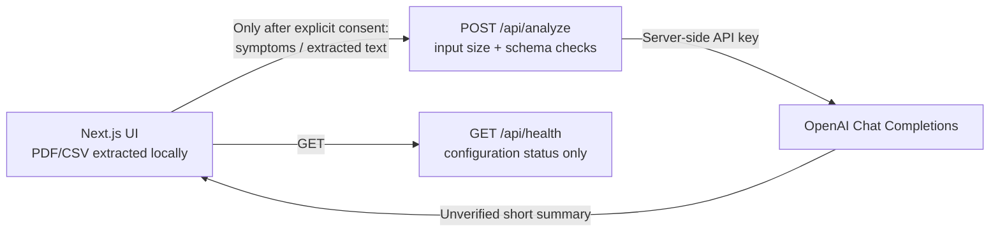

# MediBot

> **A calmer, clearer way to prepare for a conversation about your health.**

**GitHub description:** A privacy-conscious health-information assistant prototype with local report text extraction and opt-in AI summaries to help prepare for clinician conversations.

MediBot is a responsive web application prototype exploring how people could bring health documents and personal questions together in one approachable workspace. It pairs a premium, accessible dashboard with a report intake flow, a browser-based text extraction preview, and guided next steps for preparing to speak with a care provider.

MediBot can create an optional, AI-generated informational summary of symptom text or extracted text from a report. It is **not a medical analysis service**: it does not diagnose, prescribe, or determine whether it is safe to delay care. Text-based PDFs and CSV files are extracted in the browser first. AI analysis is off until the user opts in, and submitted text is sent to OpenAI for processing. The app does not save reports or AI requests.

## What you can try

- **Add a report:** Select or drag in up to five text-based PDF or CSV files (maximum 25 MB each). PDF text is extracted in the browser and displayed as a preview; CSV content is shown as text.
- **Create an AI summary:** Explicitly opt in to send your symptom description or extracted text to OpenAI. The summary provides general observations and questions to discuss with a healthcare professional. Review extracted text before choosing to send it.
- **Describe a concern:** Enter a symptom note or try browser-supported voice input. Voice recognition depends on browser support.
- **Review the workspace:** The selected-report list reflects files added in the current browser session only; it is not a saved report library.
- **Choose whether to share location:** The provider-discovery card requests browser location permission only after you choose it. Provider search is not connected.
- **Prepare a visit summary:** Open the browser print dialog to print or save the current page.

## Privacy and safety

- File reading and PDF text extraction happen in the browser. Files are not stored by MediBot or uploaded as files. If you opt in to AI analysis, the text you selected is sent from the server to OpenAI; review OpenAI's applicable privacy and data controls before using the feature with health information.
- The OpenAI API key is held by the server and must never be added to browser code or committed to source control. AI request bodies and report contents are not logged or stored by the analysis route.
- Scanned/image-only PDFs and image files are not supported; OCR is not configured.
- There is no clinician review workflow, provider directory, appointment booking, account system, or report storage.
- This prototype is not a medical device or a substitute for professional medical advice. Do not use it to make health decisions.
- Do not describe this project as HIPAA- or GDPR-compliant. A production service would require appropriate legal, clinical, security, privacy, and vendor review before handling health information.

## Tech stack

- [Next.js](https://nextjs.org/) App Router and React
- TypeScript
- Custom responsive CSS
- [Lucide](https://lucide.dev/) icons
- [PDF.js](https://mozilla.github.io/pdf.js/) for in-browser extraction of selectable PDF text
- OpenAI Chat Completions API, called from a Next.js server route when the user explicitly opts in

## Current architecture and data flow



The deployed app is a single Next.js service. There is no separate Python backend, LangChain pipeline, approved reference corpus, embeddings, vector store, authentication, persistent conversation store, or medical knowledge ingestion workflow. Therefore the current OpenAI feature summarizes only the user-provided text; it is **not RAG** and has no source citations. Do not use it as a diagnostic or treatment tool.

### API

- `GET /api/health` reports service status and whether `OPENAI_API_KEY` is configured; it does not expose the secret.
- `POST /api/analyze` accepts JSON such as `{"symptoms":"...","reports":["..."]}`. Input is bounded and requires the user to opt in at the UI. Returns a short summary, observations, questions, or a sanitized error. The API key remains server-side.
- `GET /api/analyze` is not supported (405).

## Run locally

Requirements: Node.js and npm.

```bash
npm install
npm run dev
```

For the AI summary, create `.env.local` in the project root:

```dotenv
OPENAI_API_KEY=your-server-side-openai-api-key
OPENAI_MODEL=gpt-4o-mini
```

Keep `.env.local` private; do not commit it or prefix the key with `NEXT_PUBLIC_`. Restart the dev server after changing environment variables. Without `OPENAI_API_KEY`, local report extraction still works, but the AI endpoint responds with a setup message.

On Render, add `OPENAI_API_KEY` as a secret environment variable in the service settings. `OPENAI_MODEL` is optional; if omitted the app uses `gpt-4o-mini`. Redeploy after saving the variables.

Render settings for this Next.js service:

- Build command: `npm install && npm run build`
- Start command: `npm run start`
- Health check path (if enabled): `/api/health`
- Required secret: `OPENAI_API_KEY`
- Optional variable: `OPENAI_MODEL` (defaults to `gpt-4o-mini`)

Open [http://localhost:3000](http://localhost:3000). If port 3000 is already in use, Next.js will report the alternate local port it selected.

## Quality checks

```bash
npm run build
npm run typecheck
npm audit
```

## Current limitations

- PDF extraction reads selectable text only; it does not perform OCR.
- CSV is presented as source text; there is no clinical variable parsing or terminology mapping.
- Report content is not normalized to medical codes or compared against validated reference intervals. An AI summary may be wrong and must not guide treatment decisions.
- There is no LangChain integration, RAG, approved knowledge corpus, vector database, source citations, or persistent chat/conversation memory.
- There is no production rate limiter or authentication; do not expose this prototype as a healthcare service or send real patient information.
- Provider search, appointment booking, secure sharing, authentication, audit logging, and data-deletion services are not implemented.
- The session report list is not persistent.

## RAG prerequisites and next architecture step

A grounded RAG release must first select an approved, maintained medical reference corpus and a persistent vector store (for example, managed PostgreSQL with pgvector). Render needs persistent database credentials; model and embedding API keys must be server-side. The ingestion flow must be administrator-authorized, deduplicate/version sources, retain page/source metadata, and expose citations only for retrieved chunks. Conversation history must remain ephemeral until authentication and per-user isolation exist. None of these external resources or credentials are currently configured, so they are not represented as working features here.

## Troubleshooting

- **AI setup message:** Add `OPENAI_API_KEY` to Render environment variables and redeploy. Verify `GET /api/health` returns `"aiConfigured": true`.
- **Invalid-key response:** Replace the Render secret with a valid key for an enabled OpenAI project; do not put it in client code or commit it.
- **Rate-limited response:** Check provider usage and account limits, then retry later.
- **PDF has no selectable text:** It is likely image-only; OCR is not configured.
- **AI response is unavailable:** Review the public service status and Render logs for startup/provider errors. Do not log or paste report text or secrets into logs/issues.
- **No answer sources:** This version does not perform retrieval and cannot provide knowledge-base citations.

## Direction for a production service

A real health service would need a carefully scoped backend; authenticated, per-user access controls; secure document processing and retention/deletion workflows; validated OCR and terminology mapping; evaluated clinical safety behavior with clinician oversight; approved model and provider-data integrations; audit trails; accessibility and security testing; and jurisdiction-specific privacy and regulatory review. Treat each as unimplemented until designed, built, independently reviewed, and tested.
